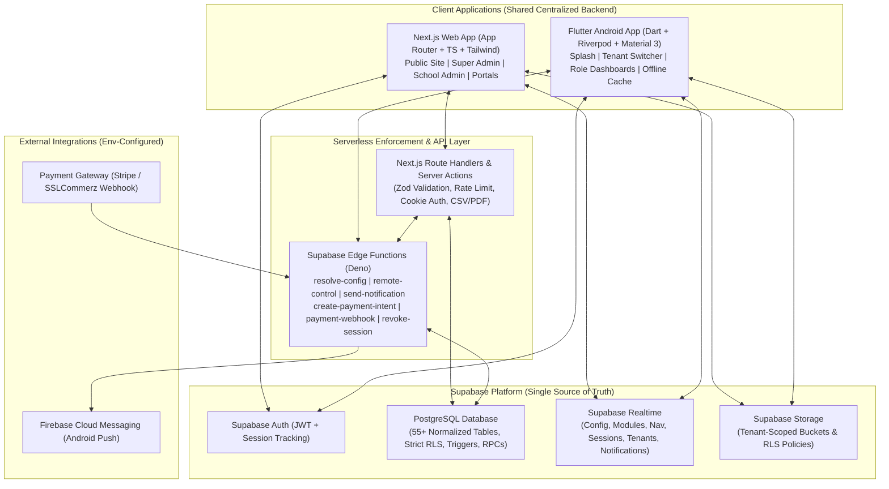

# CampusOS — Technical Architecture

**Project:** CampusOS ("One Platform. Every Campus.")  
**Classification:** Enterprise Multi-Tenant School Management SaaS Platform  
**Clients:** Next.js Web Application (Public + Super Admin + School Admin + Portals) & Flutter Android Application  
**Backend:** Centralized Supabase (PostgreSQL + RLS + Auth + Realtime + Storage + Edge Functions)

---

## 1. High-Level System Architecture



---

## 2. Multi-Tenant SaaS Isolation Model

### 2.1 Zero-Trust Tenant Resolution
1. **No client-supplied tenant trust:** Any `tenant_id` or `tenant_slug` sent via headers, query params, or JSON body is treated strictly as a *selector candidate*, never as authorization.
2. **Server-Side Membership Proof:** Every authenticated request resolves `auth.uid()` from the verified Supabase JWT/session cookie, queries `tenant_memberships` (`status = 'active'` and `deleted_at IS NULL`) joined with `tenants` (`status = 'active'` and `deleted_at IS NULL`), and verifies `user_sessions` has not been remotely revoked.
3. **Database-Enforced Isolation (PostgreSQL RLS):**
   - Every tenant-owned record carries `tenant_id UUID NOT NULL REFERENCES public.tenants(id)`.
   - Every table has `ALTER TABLE ... ENABLE ROW LEVEL SECURITY;` with zero permissive public policies on private data.
   - `SECURITY DEFINER` helper functions inside the `app` schema evaluate identity, tenant status, membership, role permissions, module enablement, guardian-child linkage, and teacher-class assignment directly inside PostgreSQL.
4. **Multi-Tenant Memberships:** A single user (`profiles.id = auth.uid()`) may belong to multiple institutions via `tenant_memberships`. Switching institutions updates the active context and re-resolves effective permissions and remote configuration.
5. **Suspended / Deactivated Tenant Lockout (Test D):** Setting `tenants.status` to `'suspended'` or `'deactivated'` immediately causes `app.is_tenant_active(tenant_id)` to evaluate to `false` inside RLS policies and `resolve_effective_config` RPC, blocking all tenant reads/writes and pushing a Realtime state update that locks out active Web & Android sessions.

---

## 3. Hierarchical Dynamic Remote Configuration Engine

CampusOS implements a deterministic 5-layer cascade evaluated server-side and cached safely on clients:

```
1. GLOBAL PLATFORM POLICY      (platform_settings, global_config, maintenance_mode, global_features)
          ↓
2. SUBSCRIPTION ENTITLEMENTS   (subscriptions -> subscription_plans -> allowed_modules & quotas)
          ↓
3. TENANT CONFIGURATION        (app_config [scope='tenant'], tenant_features, tenant branding/theme)
          ↓
4. USER ROLE PERMISSIONS       (tenant_memberships -> roles -> role_permissions & module permissions)
          ↓
5. WEB & MOBILE INTERFACE      (resolved navigation, dashboard widgets, active theme, enabled modules)
```

### 3.1 Configuration Lifecycle & Versioning
- **Snapshot Versioning:** Every mutation via `publish_remote_config_version` increments `version_number`, stores an immutable JSON snapshot (`configuration_versions`) including `global_config`, `modules`, `navigation_items`, `dashboard_widgets`, and `theme_tokens`, and logs an entry in `audit_logs`.
- **1-Click Rollback (Test E):** `rollback_remote_config_version(target_version_id)` restores the exact state of `app_config`, `modules`, `navigation_items`, and `dashboard_widgets` from the immutable snapshot inside a single database transaction, writes a new active version number (referencing `restored_from_version_id`), and notifies all connected clients via Realtime.
- **Synchronization Triggers:** Both Next.js and Flutter fetch `resolve_effective_config`:
  - On Application Launch / SSR Request
  - On Login & Tenant Switch
  - On Auth Session Refresh
  - On Network Reconnection
  - Immediately upon Realtime change events on `app_config`, `configuration_versions`, `modules`, `tenant_features`, `navigation_items`, `dashboard_widgets`, `tenants`, and `user_sessions`.
- **Safe Caching & Fallback:** Flutter stores the last verified signed/versioned config payload in local cache (`SharedPreferences`) paired with `version_number` and `tenant_id`. If offline on cold start, cached config renders safely; upon reconnection, stale cache is immediately reconciled. If no cache exists, a minimal safe fallback layout (Login/Settings/Maintenance check) renders without exposing restricted routes.
- **Security Guarantee:** Hiding a module in UI navigation is *never* the security boundary. RLS and Edge/API route guards call `app.is_module_enabled_for_tenant(tenant_id, module_key)` and `app.has_tenant_permission(tenant_id, permission_key)` before executing operations.

---

## 4. Brand & Design System

- **Brand Name:** CampusOS — *"One Platform. Every Campus."*
- **Official Assets:**
  - Logo (`campusos-logo.jpg`): Mortarboard cap + emerald orbit swoosh + clock schoolhouse + open book + `CampusOS` wordmark with power symbol in `O`.
  - Feature Banner (`campusos-banner.jpg`): Dark emerald gradient hero, interactive glass feature cards, laptop + mobile preview mockups.
- **Design Tokens (Default + Remotely Overridable):**
  - `primary`: `#16A34A`
  - `emerald`: `#22C55E`
  - `darkGreen`: `#064E3B`
  - `black`: `#111827`
  - `charcoal`: `#1F2937`
  - `white`: `#FFFFFF`
  - `lightBg`: `#F8FAFC`
- **Modes:** Full Light Mode & Dark Mode support synchronized with user preference and remote theme presets.

---

## 5. Key Security Boundaries

1. **Private Key Protection:** `SUPABASE_SERVICE_ROLE_KEY`, payment webhook secrets, and `FIREBASE_SERVICE_ACCOUNT_JSON` exist ONLY in server environment variables (`Next.js` server routes and `Supabase Edge Functions`). Never prefixed with `NEXT_PUBLIC_` and never bundled into Flutter assets/dart-define.
2. **Role & Ownership Enforcement:**
   - **Super Admin:** Verified via `platform_admins` (`is_active = true`).
   - **School Admin:** Scoped exclusively to assigned `tenant_id`.
   - **Teacher:** Attendance, homework, assignments, and marks restricted to classes/subjects explicitly assigned via `class_subjects` / `teachers`.
   - **Parent:** Child data restricted strictly to `student_guardians` (`guardian_user_id = auth.uid()`).
   - **Student:** Read access restricted strictly to own `students` record (`user_id = auth.uid()`) and published results/notices.
3. **Device & Session Revocation:** Every active client registers in `device_registrations` and tracks a session record in `user_sessions`. Revoking a session marks `revoked_at = NOW()`, rejects subsequent privileged RPCs/config fetches, and triggers immediate client sign-out via Supabase Realtime.
4. **Payment Integrity:** Payment intent creation happens server-side (`create-payment-intent`); payment completion occurs ONLY via verified server-side webhook signatures (`payment-webhook`). Never simulates successful real payment settlements.
